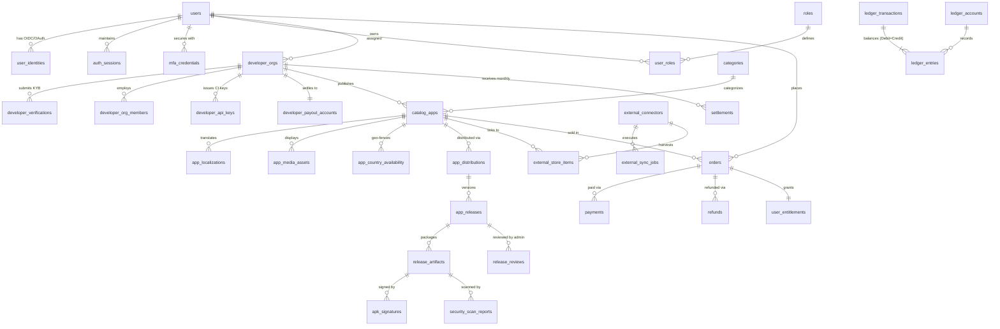

# ERD.md — 엔티티 관계 다이어그램(ERD) 및 3대 동일성 분리 구조

- **문서 ID**: `DOC-DB-001`
- **관련 문서**: [TABLE_DICTIONARY.md](TABLE_DICTIONARY.md), [INDEX_AND_QUERY_DESIGN.md](INDEX_AND_QUERY_DESIGN.md), [0001_initial_schema.up.sql](migrations/0001_initial_schema.up.sql)

---

## 1. 핵심 3대 동일성(Identity) 분리 아키텍처 (제8조 핵심 요구사항)

본 데이터베이스는 다음 3가지 엔티티 계층을 엄격히 분리하여 외부 앱 검색(Type 2)과 자체 앱스토어 배포(Type 1)가 통합 마켓(Type 3)에서 충돌하지 않도록 보장합니다:

```
┌─────────────────────────────────────────────────────────────────────────┐
│ 1. 앱 카탈로그 동일성 (Catalog Identity)                                 │
│    Table: catalog_apps (id UUID PK, canonical_slug, primary_package_name)│
│    역할: 사용자에게 보여지는 단일 논리적 앱 상품 페이지                   │
└───────────────────────────────────┬─────────────────────────────────────┘
                                    │ 1 : N
                                    ▼
┌─────────────────────────────────────────────────────────────────────────┐
│ 2. 배포처 동일성 (Distribution Source Identity)                          │
│    Table: app_distributions (id UUID PK, app_id FK, source_type,         │
│           distribution_mode, rights_level, package_name,                 │
│           signing_cert_sha256, official_store_url)                       │
│    역할: BN_HOSTED(직접배포), FDROID_REPO, GOOGLE_PLAY_LINK 등 출처 분리 │
└───────────────────────────────────┬─────────────────────────────────────┘
                                    │ 1 : N
                                    ▼
┌─────────────────────────────────────────────────────────────────────────┐
│ 3. 릴리스·아티팩트 및 앱 서명 동일성 (Release & Signature Identity)      │
│    Tables: app_releases (version_code, release_track, rollout_percentage)│
│            release_artifacts (sha256_checksum, min_sdk, native_abis)     │
│            apk_signatures (cert_sha256_fingerprint, proof_of_rotation)   │
│    역할: 실제 Android OS가 업데이트 덮어쓰기 호환성을 판별하는 물리적 단위│
└─────────────────────────────────────────────────────────────────────────┘
```

---

## 2. 도메인별 테이블 관계 요약 (Mermaid / Text ERD)



---

## 3. 외래키 참조 무결성 및 삭제 정책 (`ON DELETE` Policy Matrix)

| 부모 테이블 | 자식 테이블 | 외래키 컬럼 | `ON DELETE` 정책 | 설계 근거 (Data Loss Prevention) |
| :--- | :--- | :--- | :---: | :--- |
| `users` | `orders`, `payments`, `refunds` | `user_id` | `RESTRICT` | 전자상거래법상 결제·환불 기록은 5년간 보존해야 하므로 회원 탈퇴 시 계정을 익명화(`DELETED_ANONYMIZED`)할 뿐 물리적 행 삭제를 차단함 |
| `developer_orgs` | `catalog_apps`, `orders`, `settlements` | `owner_org_id`, `org_id` | `RESTRICT` | 유료 구매자나 정산 이력이 존재하는 개발자 조직은 임의 삭제 불가 |
| `catalog_apps` | `app_distributions`, `app_releases` | `app_id` | `RESTRICT` | 배포 이력 및 보안 감사 추적성 보존을 위해 물리적 삭제 금지 (`ARCHIVED` 상태로 전환) |
| `app_releases` | `release_artifacts`, `release_reviews` | `release_id` | `RESTRICT` | 출시된 바이너리 해시와 심사 기록의 영구 보존 |
| `ledger_transactions` | `ledger_entries` | `transaction_id` | `RESTRICT` | 복식부기 회계 원장은 어떠한 경우에도 삭제 불가 |
| `catalog_apps` | `app_localizations`, `app_media_assets` | `app_id` | `CASCADE` | 아직 출시되지 않은 초안(`DRAFT`) 앱 정리 시 종속 다국어/이미지 함께 정리 |
| `users` | `auth_sessions`, `mfa_credentials` | `user_id` | `CASCADE` | 세션 및 인증 수단은 사용자 계정에 전속됨 |
