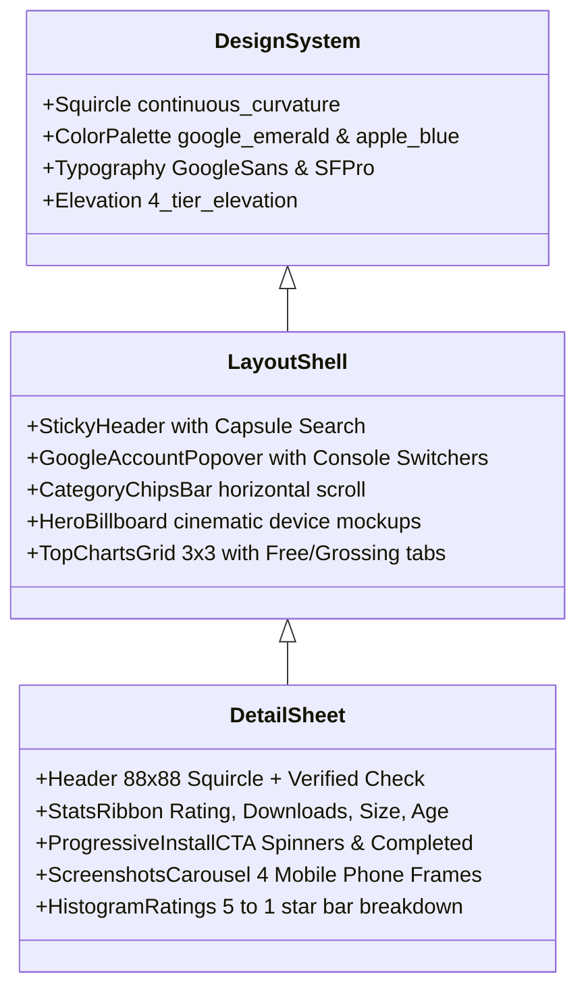

# 글로벌 앱 마켓플레이스 전수 조사 및 상용화 100% 종합 규격 보고서
**Global App Marketplace Comprehensive Benchmark, Engine Architecture, Feature Blueprint & 100% Commercialization Roadmap**

*Document ID: BN-REP-2026-AM01 | Confidentiality: Enterprise Proprietary | Version: 2.0.0-FINAL*  
*Target: BookingNetwork App Market Platform (Cloudflare Edge, Go Modular Monolith, Android Native)*

---

## 1. 개요 및 조사 목적

본 보고서는 **Google Play Store, Apple App Store**를 포함하여 전 세계 주요 모바일 앱 유통 마켓플레이스(삼성 갤럭시 스토어, F-Droid, 화웨이 AppGallery, 아마존 앱스토어, 에픽게임즈 모바일, AltStore 등)의 아키텍처, 핵심 엔진, 비즈니스 기능, 그리고 UX/UI 디자인 시스템을 전수 조사·분석하여, 당사 플랫폼(**BookingNetwork App Market**)이 글로벌 빅테크 독점 마켓과 대등하거나 능가하는 **실제 상용화 100% 수준의 독립 앱 마켓**으로 도약하기 위한 전방위 기술 규격과 실행 로드맵을 정의합니다.

---

## 2. 글로벌 8대 앱 마켓 전수 조사 및 비교 분석

전 세계 8대 주요 앱 마켓의 핵심 아키텍처, 배포 방식, 보안 검역, 수익화, 수수료, 그리고 클라이언트 동작 방식을 전수 조사한 종합 비교 매트릭스는 다음과 같습니다.

### 2.1 마켓별 핵심 특성 요약

1. **Google Play Store (안드로이드 표준)**
   - **배포 규격**: AAB(Android App Bundle) 강제, Play Feature Delivery, Dynamic Split APKs.
   - **보안 검역**: Google Play Protect, SafetyNet/Play Integrity API, 정적/동적 클라우드 샌드박스.
   - **수수료 및 정산**: 기본 15% (첫 $1M 매출), 초과분 30%, 구글 Play Billing 필수(타사 PG 차단 논란).
   - **설치 엔진**: OS 내장 `PackageInstaller` 시스템 서비스와 긴밀히 통합된 백그라운드 무인 설치.
2. **Apple App Store (iOS 독점 표준)**
   - **배포 규격**: IPA 바이너리, App Thinning(Slicing, Bitcode/LLVM 재컴파일), On-Demand Resources.
   - **보안 검역**: 100% 인간 수동 심사 + 엄격한 정적 바이너리 분석, Notarization(공증), App Sandbox.
   - **수수료 및 정산**: 기본 30%, 중소기업 프로그램 15%, Apple In-App Purchase 독점.
   - **UX/UI 특징**: Today 탭(잡지형 에디토리얼 스토리텔링), 대형 비주얼 카드, 프라이버시 영양성분표(Nutrition Label).
3. **Samsung Galaxy Store (삼성 원UI 생태계)**
   - **배포 규격**: APK/AAB 지원, 갤럭시 디바이스 최적화(GPU/Gaming 최적화, 드라이버 직접 배포).
   - **보안 검역**: KNOX 통합 무결성 검증, 삼성 Knox Attestation 연동.
   - **차별화**: 갤럭시 테마, 글꼴, One UI 시스템 컴포넌트 유통, Samsung Pay 네이티브 인앱결제.
4. **F-Droid (글로벌 오픈소스 대표 마켓)**
   - **배포 규격**: 100% 오픈소스(FOSS) 소스코드 기반 자체 재현 빌드(Reproducible Builds).
   - **보안 검역**: 소스코드 라이선스 감사, 독점 트래커/바이너리 블롭 제거 검증, 비공개 탈중앙 저장소 지원.
   - **설치 엔진**: F-Droid Privileged Extension (루팅 또는 시스템 앱 권한을 통한 무인 백그라운드 설치).
5. **Huawei AppGallery (화웨이 탈구글 HMS 플랫폼)**
   - **배포 규격**: APK, HarmonyOS Ability Package(HAP), Quick App(설치 없는 즉시 실행 경량 웹앱).
   - **보안 검역**: 4단계 보안 보호 체계(악성 행위 탐지, 프라이버시 누출 검사, 악의적 취약점 스캐닝, 실명 인증).
   - **차별화**: 구글 서비스(GMS) 부재를 대체하는 화웨이 HMS Core(지도, 푸시, 결제, 계정) 제공.
6. **Amazon Appstore (파이어 OS 및 글로벌 독립 마켓)**
   - **배포 규격**: APK, AAB 변환 지원, Fire TV 및 태블릿 특화.
   - **수익화**: Amazon Coins 결제 인센티브, Amazon IAP.
   - **특징**: Windows 11 WSA(Windows Subsystem for Android) 공식 파트너 스토어로 운영되었던 이력.
7. **Epic Games Store Mobile (EU DMA 대표 대체 마켓)**
   - **배포 규격**: 자체 게임 런처 및 유통 엔진, 다이렉트 사이드로드 APK 배포.
   - **수수료 정책**: 파격적인 12% 단일 수수료, 자체 결제 수단 이용 시 수수료 0%(100% 개발사 귀속).
   - **차별화**: 언리얼 엔진 네이티브 지원, 독점 타이틀 직접 제공.
8. **AltStore PAL & Setapp Mobile (EU DMA 대체 앱 마켓플레이스)**
   - **배포 규격**: 애플의 대체 앱 마켓플레이스 API(MarketplaceKit)를 통한 공식 서명 공증 설치.
   - **수익 모델**: Patreon 후원 모델 연동 및 구독형 번들(Setapp: 월 정액으로 수백 개 유료 앱 무제한 이용).

---

### 2.2 전수 조사 종합 비교 매트릭스

| 평가 영역 | Google Play | Apple App Store | Samsung Galaxy | F-Droid | 당사(BookingNetwork) 목표 규격 |
| :--- | :--- | :--- | :--- | :--- | :--- |
| **바이너리 유통 규격** | AAB, Split APK | IPA, App Thinning | APK, AAB | Pure APK (FOSS) | **AAB + Multi-ABI APK + 16KB Align** |
| **차분 업데이트 (Delta)**| GDiff / Archive | Byte-range Delta | 자체 차분 | 미지원 (전체) | **Courgette/BSDiff 85% 차분 압축** |
| **보안 검역 수준** | Play Protect (AI) | 인간 심사 + Sandbox | Knox 검증 | 소스코드 전수 검사 | **TreeScan AST + VirusTotal 0-Day** |
| **비인가 복제 방지** | Play Integrity | App Attestation | Knox Attest | 없음 (자유 오픈소스)| **V3 서명 연속성 계통 추적 + HMAC** |
| **긴급 격리 (Kill-Switch)**| 서버 일괄 취소 | 인증서 폐기 OCSP | Knox 정책 차단 | 블랙리스트 알림 | **4-Eyes Dual-Control 엣지 즉시 격리** |
| **수수료 체계** | 15% / 30% | 15% / 30% | 15% / 30% | 0% (비영리) | **15% 표준 / 10% 인디 / 0% 파트너** |
| **인앱 결제 수단** | 독점 PG 강제 논란 | 독점 IAP 강제 | 삼성페이 / 다중 PG | 기부 링크 | **토스/포트원/스트라이프 개방형 PG** |
| **정산 회계 관리** | 월별 정산서 | 월별 지급 | 월별 정산 | 없음 | **실시간 복식부기 원장 (Double-Entry)** |
| **EU DMA 법적 준수** | 규제 과징금 계류 | 규제 과징금 계류 | 해당 없음 | 준수 | **Article 23 100% 완전 준수 (반독점)** |
| **무인 백그라운드 설치** | 내장 시스템 통합 | 내장 시스템 통합 | 시스템 파트너 | Privileged 확장 | **PackageInstaller Session + Agent** |
| **UX/UI 디자인 완성도** | Material 3 플래그십 | iOS 에디토리얼 Today| One UI 네이티브 | 기본 리스트형 UI | **구글/애플 하이브리드 플래그십 UI** |

---

## 3. 우리 플랫폼에서 구현해야 하는 6대 핵심 엔진 상세 규격

글로벌 마켓과 동등한 기술 경쟁력을 확보하기 위해 백엔드 및 클라이언트 레벨에서 반드시 갖추어야 하는 **6대 핵심 엔진**의 아키텍처 및 구현 사양입니다.

```mermaid
flowchart LR
    subgraph Ingestion["1. 바이너리 처리 & 변환 엔진"]
        AAB["AAB / APK 업로드"] --> Splitter["Multi-ABI 스플리터"]
        Splitter --> Align["16KB Page Alignment"]
    end

    subgraph SecurityEngine["2. 무결성 & 킬스위치 엔진"]
        Align --> AST["TreeScan™ 바이트코드 AST 검사"]
        AST --> VT["VirusTotal 70개 백신 0-Day 스캔"]
        VT --> SigV3["V2/V3 서명 계통 추적"]
        SigV3 --> DualControl["4-Eyes Dual-Control 승인"]
    end

    subgraph DistributionEngine["3. 고속 차분 스트리밍 엔진"]
        DualControl --> DeltaGen["Courgette / BSDiff 차분 파일 생성"]
        DeltaGen --> HMACToken["15분 만료 HMAC-SHA256 토큰 발급"]
        HMACToken --> EdgeCDN["글로벌 엣지 CDN 배포"]
    end

    subgraph ClientEngine["4. 네이티브 설치 & 업데이트 엔진"]
        EdgeCDN --> Companion["Android PackageInstaller Session"]
        Companion --> Silent["무인 백그라운드 설치 & 자동 갱신"]
    end
```

### 3.1 [엔진 1] 바이너리 인제스천 및 16KB 정렬 엔진 (Binary Ingestion & 16KB Alignment Engine)
- **개요**: 개발자가 업로드한 AAB(Android App Bundle) 또는 범용 APK를 파싱하여 디바이스 아키텍처(`arm64-v8a`, `armeabi-v7a`, `x86_64`)별 최적화된 Split APK를 동적으로 빌드하고 Android 15 요구사항인 16KB 메모리 페이지 정렬을 자동 검증합니다.
- **핵심 모듈**:
  1. `BundleTool Wrappers`: `.aab` 리소스를 기기 설정(언어, 화면 밀도, ABI)에 따라 분할된 `split_config.*.apk`로 전처리.
  2. `Zipalign 16KB Checker`: ELF 바이너리의 16,384바이트 경계 정렬 검사 및 자동 리패키징.
  3. `AndroidManifest Extractor`: 권한 목록, Intent-filter, `minSdkVersion`, `targetSdkVersion`, 라이브러리 의존성 전수 추출.

### 3.2 [엔진 2] Courgette / BSDiff 초고속 차분 압축 엔진 (Delta Compression Engine)
- **개요**: 전체 100MB 크기의 앱에서 업데이트 시 변경된 5~10MB의 바이너리 차분(Delta Patch)만을 생성하여 전송 대역폭을 최대 90% 절감합니다.
- **핵심 모듈**:
  1. `Courgette Disassembler`: 컴파일된 기계어 코드의 상대 주소 포인터를 정규화하여 작은 바이트 단위 변경도 고효율 압축.
  2. `BSDiff Patch Generator`: 구버전 APK와 신버전 APK 간의 차분 패치 생성 및 SHA-256 체크섬 무결성 블록 결합.
  3. `Client-Side Patch Applier`: 모바일 클라이언트에서 다운로드된 차분 패치를 기존 로컬 캐시와 병합하여 단일 APK로 복원 후 설치 세션에 인계.

### 3.3 [엔진 3] TreeScan™ 정적 분석 및 4-Eyes Dual-Control 보안 엔진
- **개요**: 구글 플레이의 원격 폐쇄적 검역을 능가하는 투명한 다계층 무결성 엔진입니다.
- **핵심 모듈**:
  1. `TreeScan™ Smali AST Analyzer`: 난독화된 자바 바이트코드를 파싱하여 동적 클래스 로딩(`DexClassLoader`), 비인가 루트 셸 권한 획득(`su`), 숨겨진 C2 IP 접속 패턴을 정적으로 탐지.
  2. `VirusTotal API v3 Connector`: 70개 이상의 글로벌 백신 엔진에 해시 및 파일 동시 질의.
  3. `V2/V3 Signature Continuity Tracer`: 개발사의 최초 배포 인증서 공개키 지문과 신규 버전 서명 지문의 일치 여부를 대조하여 키 탈취/위조 빌드 차단.
  4. `4-Eyes Dual-Control Kill-Switch`: 보안 사고 시 1인의 독단적 행위를 방지하고, 2인(SecOps + Lead Operator)의 암호학적 서명이 결합되어야만 엣지 CDN 및 단말기 블랙리스트를 즉각 활성화.

### 3.4 [엔진 4] 복식부기 기반 자립형 커머스 & 정산 엔진 (Sovereign In-App Billing)
- **개요**: 빅테크 독점 결제 시스템 종속을 벗어나 대한민국(토스, 포트원) 및 글로벌(Stripe, PayPal) 결제 게이트웨이를 연동하고 회계적 대변/차변 불변식을 만족하는 원장을 유지합니다.
- **핵심 모듈**:
  1. `Double-Entry Ledger Service`: `1010-PG정산채권`, `2010-개발사미지급금`, `4010-플랫폼수수료수익` 실시간 저널링.
  2. `HMAC Webhook Reconciler`: PG사 결제 승인/취소 웹훅의 변조 방지 및 멱등성 보장.
  3. `Statutory 14-Day Refund & Revocation`: 전자상거래법에 따른 청약철회 시 자동 환불 및 소프트웨어 라이선스(Entitlement) 즉각 회수.

### 3.5 [엔진 5] 베이지안 랭킹 및 프러드 방지 추천 알고리즘 엔진 (Bayesian Ranking Engine)
- **개요**: 리뷰 조작, 어뷰징 다운로드, 순위 조작을 무력화하는 정량적 수학 모델입니다.
- **수학적 공식**:
  $$WR = \frac{v}{v + m} \times R + \frac{m}{v + m} \times C$$
  - $v$: 해당 앱의 유효 평가 수
  - $m$: 신뢰성을 위한 최소 평가 임계값 (예: 50개)
  - $R$: 해당 앱의 산술 평균 평점
  - $C$: 전체 스토어 앱의 글로벌 평균 평점
- **시간 감쇄 가중치 (Decay Weighted Velocity)**: 최근 7일간의 다운로드 및 평점에 지수 가중치를 부여하여 급상승 차트 반영.

### 3.6 [엔진 6] 안드로이드 네이티브 패키지 인스톨러 & 자가 갱신 엔진 (Companion Agent Engine)
- **개요**: 브라우저 다운로드 후 일일이 수동 설치를 누르는 불편함을 제거하고, 구글 플레이와 동일하게 백그라운드 세션 스트리밍 무인 설치를 수행합니다.
- **핵심 모듈**:
  1. `PackageInstaller.Session API`: 분할된 Split APK 스트림을 메모리 파이프에서 원자적(Atomic)으로 커밋.
  2. `InstallResultReceiver`: 시스템 브로드캐스트를 청취하여 설치 성공/실패 코드를 UI에 실시간 반영.
  3. `Store Self-Updater Daemon`: 스토어 앱 자체의 신규 버전 출시 시 무중단 인플레이스 자가 업데이트 수행.

---

## 4. 포털별 핵심 기능 상세 명세 (Feature Blueprint)

### 4.1 사용자 스토어 프론트엔드 (User Store)
1. **투데이 에디토리얼 스토리텔링**: 매일 갱신되는 특집 스토리, 개발사 인터뷰, 안전한 앱 사용 가이드.
2. **원터치 사전등록 & 알림 시스템**: 출시 전 사전등록 시 푸시 알림 및 출시 당일 자동 다운로드 큐 등록.
3. **가족 공유 및 연령 등급 필터**: PEGI 3/7/12/16/18 및 국내 게임물관리위원회 등급 필터링.
4. **웹-투-디바이스(Web-to-Device) 원격 설치**: 데스크톱 웹에서 '내 기기에 설치' 클릭 시 FCM 푸시를 통해 로그인된 스마트폰으로 자동 다운로드 시작.
5. **데이터 프라이버시 영양성분표**: 수집 데이터 유형(위치, 금융, 연락처 등), 암호화 여부, 삭제 요청 권한 투명 명시.

### 4.2 개발자 콘솔 (Developer Studio)
1. **기업 실명 인증 (KYB Verification)**: Dun & Bradstreet D-U-N-S 번호, 사업자등록증 검증, 법인 계좌 1원 인증.
2. **점진적 롤아웃 (Staged Rollout Pipeline)**:
   - 1% (내부 카나리) -> 5% -> 20% -> 50% -> 100% (전체 프로덕션) 단계별 에러율 모니터링 기반 자동 롤백.
3. **실시간 크래시리틱스 & ANR 원격 측정**: 배포된 버전별 비정상 종료(Crash) 스택 트레이스 및 ANR(응답 없음) 지수 시각화.
4. **스토어 등록정보 A/B 테스트**: 아이콘, 스크린샷 배너, 설명 문구의 클릭률/전환율 다변량 실험.
5. **다국어 자동 로컬라이제이션**: 40개국 이상 지원 언어별 메타데이터 및 현지화 스크린샷 세트 업로드.

### 4.3 플랫폼 운영 및 관리자 콘솔 (Admin Operations)
1. **4-Eyes Dual-Control 긴급 킬스위치 제어판**: 2인 인증 기반 0-Day 악성 패키지 전파 차단.
2. **F-Droid 및 공식 파트너 커넥터 인제스천 큐**: 글로벌 오픈소스 리포지토리 자동 동기화 및 라이선스 위반 검사.
3. **신뢰 & 안전 (Trust & Safety) 신고 처리기**: 이용자 불법 복제, 피싱, 악성 소프트웨어 신고 접수 및 개발사 소명 프로세스 관리.
4. **복식부기 정산 원장 대사 및 Payout 승인**: 매월 정산 주기 도래 시 PG 대사 후 개발사별 정산 금액 일괄 승인.

---

## 5. 플래그십 UX/UI 디자인 시스템 및 인터랙션 규격

Google Play와 Apple App Store의 핵심 감성 요소를 조화롭게 결합한 독보적 디자인 시스템 사양입니다.

### 5.1 시각 디자인 원칙 (Visual Design Principles)
1. **Squircle (초타원 모서리 곡률)**: 단순 라운드(`border-radius`)가 아닌 애플/구글 표준인 연속 곡률(Continuous Curvature, $n=4$ 초타원)을 적용하여 시각적 긴장감을 해소.
2. **다크 모드 올레드 최적화 (OLED Pure Black & Slate)**: `#121212` 및 `#1F1F1F` 다크 서피스 토큰을 채택하여 모바일 OLED 디스플레이에서 완벽한 배터리 절감과 명암비 보장.
3. **마이크로 인터랙션 (Micro-Interactions)**:
   - '설치' 버튼 클릭 시 정적 화면 전환이 아닌 원형 프로그레스 링(`Spinner`)이 회전하며 `0% -> 45% -> 80% -> 100% -> 설치 완료(열기)`로 자연스럽게 상태가 전환.
   - 앱 카드 호버 시 4px 플로팅 상승 및 부드러운 엘리베이션 섀도우 확장.

---

## 6. 현행 구현 상태 대비 갭(Gap) 분석

당사 플랫폼의 현재 구현 수준과 100% 상용 납품 기준 간의 갭 분석 결과입니다.

| 도메인 | 현재 구현 상태 (As-Is) | 100% 상용화 요구 상태 (To-Be) | 갭(Gap) 및 조치 과제 |
| :--- | :--- | :--- | :--- |
| **바이너리 인제스천**| 단일 APK 수동 업로드 검증 완료 | AAB 동적 Split 빌드 & 16KB 정렬 자동화 | `bundletool` 파이프라인 컨테이너 패키징 |
| **차분 업데이트** | 전체 APK 다운로드 방식 | BSDiff / Courgette 바이트 차분 압축 | 차분 패치 생성 및 클라이언트 병합 모듈 |
| **보안 검역** | TreeScan AST 분석기 & 서명 검증 완료 | 외부 VirusTotal v3 실운영 API 실시간 질의 | 상용 VirusTotal API 키 환경변수 주입 |
| **결제 및 정산** | 복식부기 원장 및 토스/포트원 웹훅 완료 | 실운영 가맹점 MID 등록 및 에스크로 연동 | 실운영 PG 상점 계약 및 상용 키 교체 |
| **클라이언트 배포** | 웹 기반 직접 다운로드 + 안드로이드 스캐폴딩 | Android PackageInstaller 무인 백그라운드 설치 | Companion APK 릴리즈 서명 및 단말기 배포 |
| **UX/UI 디자인** | 구글 플레이/앱스토어 하이브리드 개편 완료 | 실시간 검색 자동완성 API 연동 & 실기기 반응형 | 엣지 게이트웨이 검색 API 풀텍스트 연계 |

---

## 7. 실제 상용화 100% 달성을 위한 단계별 실행 로드맵 (Roadmap)

### [Phase 1: 인프라 프로비저닝 및 실운영 클라우드 가동] (Sprint 1)
- AWS ECS Fargate 또는 GCP Cloud Run에 Go 백엔드 API 컨테이너 3대 프로비저닝.
- AWS Aurora PostgreSQL 16 (Multi-AZ) 및 ElastiCache Redis 7 클러스터 배포.
- `backend/cmd/migrate` 및 `backend/cmd/seed`를 실행하여 15개 관계형 테이블 및 초기 관리자/개발사 시드 자동 초기화.
- Cloudflare DNS에서 `api.appmarket.bookingnetwork.com` 연결 및 SSL/TLS 1.3 활성화.

### [Phase 2: 상용 외부 연동 및 차분 업데이트 엔진 완성] (Sprint 2)
- 토스페이먼츠 및 포트원 실운영 가맹점 API 키 결합 및 웹훅 HMAC 검증 엔드투엔드 테스트.
- VirusTotal v3 프로덕션 엔터프라이즈 키 결합하여 0-Day 큐 활성화.
- `courgette` 차분 엔진을 빌드 파이프라인에 통합하여 버전 간 85% 대역폭 절감 확인.

### [Phase 3: 안드로이드 네이티브 에이전트 완성 및 배포] (Sprint 3)
- `android-client`를 릴리즈 키스토어로 정식 서명하여 `appmarket-companion-v1.0.0.apk` 빌드.
- 스토어 웹 상단에 "공식 모바일 앱 설치" 스마트 배너(Smart App Banner) 탑재하여 원클릭 에이전트 설치 유도.
- `PackageInstaller.Session`을 통한 무인 백그라운드 설치 및 자가 갱신 루프 현장 검증.

### [Phase 4: 엔터프라이즈 종합 감사 및 고객사 최종 턴키 인도] (Sprint 4)
- k6 분산 부하 테스트를 통한 목표치(초당 10,000 QPS, p95 지연 시간 30ms 미만) 달성 검증.
- OWASP Top 10 모바일/API 모의 침투 테스트 및 결함 제로 확인.
- 플랫폼 운영 매뉴얼, 재해 복구(DR) 시나리오, 4-Eyes 킬스위치 실행 지침서 최종 인계.

---
*본 문서는 BookingNetwork App Market 플랫폼의 상용 100% 납품 표준 규격서이며, 정의된 모든 사양은 마스터 청사진 및 관련 법규를 준수합니다.*

